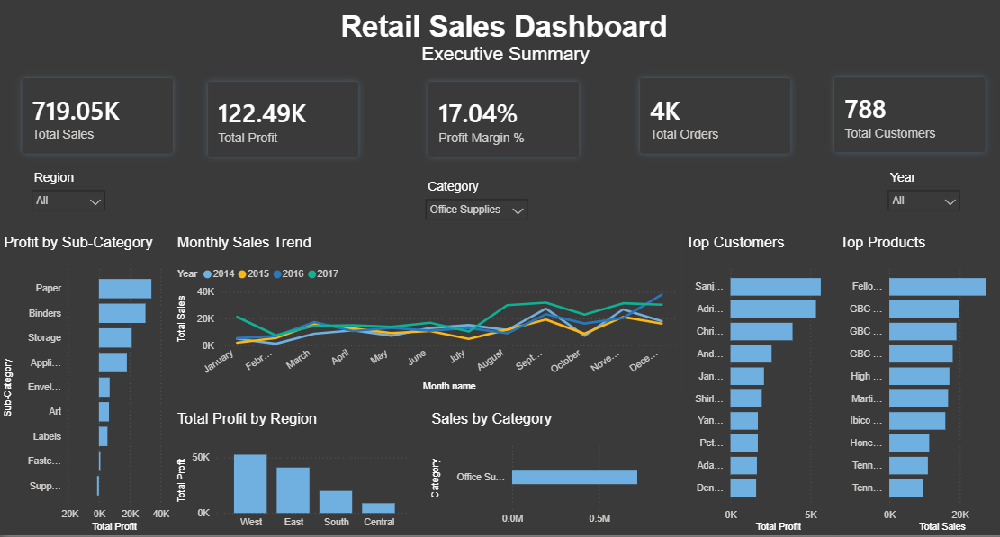

# 🛒 Retail Sales Dashboard

## 📌 Overview

An interactive Power BI dashboard that analyzes four years of retail orders (2014 – 2017) to show sales, profit and margin by category, sub-category, region, customer and product.

*The screenshot shows the dashboard with the Office Supplies category selected.*

---

## 🚀 Objectives

- Track total sales, profit, profit margin, orders and customers.
- Show how sales change month by month across years.
- Identify the most and least profitable categories, sub-categories and regions.
- Highlight the top customers and top products by sales.
- Let users filter everything by region, category and year.

---

## 📁 Dataset

`Retail_Sales.xls` contains three tables:

| Table | Rows | Description |
|---|---:|---|
| Orders | 9,994 | One row per order line: order and ship dates, ship mode, customer, segment, city, state, region, product, category, sub-category, sales, quantity, discount, profit |
| Returns | 296 | Returned orders |
| People | 4 | Regional manager per region |

| Item | Value |
|---|---:|
| Orders | 5,009 |
| Customers | 793 |
| Products | 1,862 |
| Period | Jan 2014 – Dec 2017 |
| Regions | Central, East, South, West |

The Orders table also includes helper columns for year, month name, month number and quarter. The workbook also holds the pivot tables used during exploration (profit by category, profit and average discount by sub-category, and Tables profit by region).

---

## 📈 Dashboard Features

- **KPI cards:** Total Sales, Total Profit, Profit Margin %, Total Orders, Total Customers
- **Monthly Sales Trend** by year
- **Profit by Sub-Category**
- **Total Profit by Region**
- **Sales by Category**
- **Top Customers** and **Top Products**
- **Slicers:** Region, Category, Year

---

## 🛠 Tools Used

- Microsoft Excel (data preparation, pivot tables)
- Power BI
- Data cleaning
- Data visualization

---

## 💡 Key Insights

Across all four years:

- Total sales were **$2.30M** with **$286.4K** profit, a profit margin of **12.5%**.
- **Technology** was the most profitable category ($145.5K profit). **Furniture** made about the same sales as Office Supplies ($742K) but only **$18.5K** profit.
- **Tables** (−$17.7K) and **Bookcases** (−$3.5K) lost money overall. Tables lost money in the Central, East and South regions and made a small profit only in the West.
- **West** was the most profitable region ($108.4K) and **Central** the least ($39.7K).

---

## 📂 Project Files

- `Retail Sales Analysis Dashboard.pbix`: Power BI report
- `Retail_Sales.xls`: source data and exploration pivot tables
- `dashboard.png`: dashboard screenshot

---

## 👨‍💻 Author

**Mohamed Salih**
Junior Data Analyst

- GitHub: [mosalih23-c](https://github.com/mosalih23-c)
- LinkedIn: [Mohamed Salih](https://www.linkedin.com/in/mohamed-salih-341bb0368/)
- Portfolio: [mosalih23-c.github.io/mohamed-salih-portfolio](https://mosalih23-c.github.io/mohamed-salih-portfolio/)
